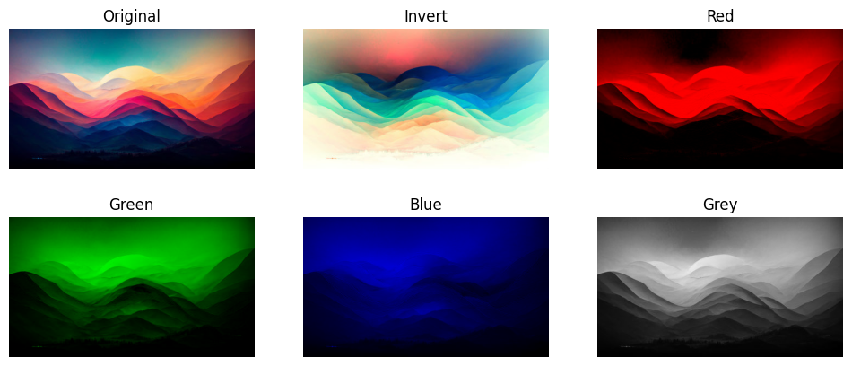

# Python for Data Science: 42 Piscine


My solutions to 42's **Python for Data Science** piscine: five short
modules of peer-graded exercises, from Python basics to NumPy, image
processing, pandas, OOP and data-oriented design.



## Modules

| Module | Topic | Status | Grade |
|--------|-------|--------|-------|
| [0 · Starting](python-0) | Python basics | Done | 100/100 |
| [1 · Array](python-1) | Arrays, NumPy, images | Done | - |
| [2 · DataTable](python-2) | pandas, matplotlib | Done | - |
| 3 · OOP | Object-oriented programming | Not started | - |
| 4 · Dod | Data-oriented design | Not started | - |

## Run it yourself

Use the same Python version as the 42 machines (3.10):

```bash
uv venv --python 3.10 .venv
source .venv/bin/activate
uv pip install -r requirements.txt
```

Every file must pass flake8. Ruff auto-fixes most issues (`ruff.toml`):

```bash
flake8 --exclude .venv .
ruff format . && ruff check --fix .
```

Each module's README shows how to run its exercises.
