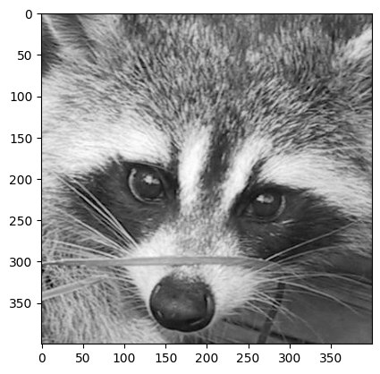
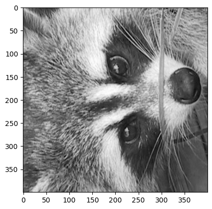
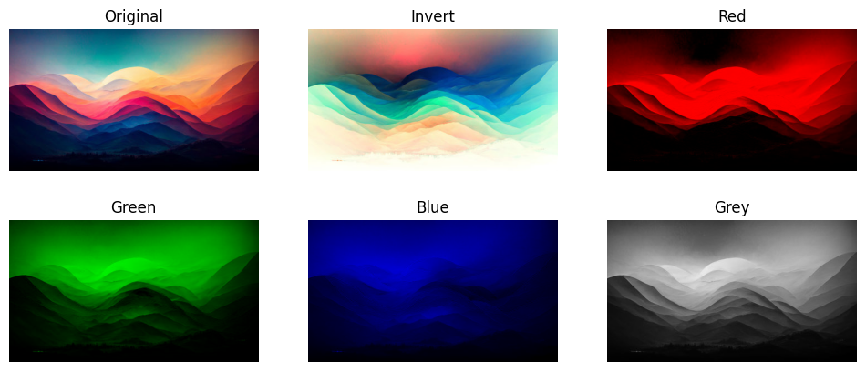

# Python - 1 - Array

## Grade

-

## Exercises

| Ex | Title | Status |
|----|-------|--------|
| 00 | Give my BMI | Done |
| 01 | 2D array | Done |
| 02 | Load my image | Done |
| 03 | Zoom on me | Done |
| 04 | Rotate me | Done |
| 05 | Pimp my image | Done |

Images used by ex02–ex05 are in [`assets/`](assets).

## Highlights

**ex03: zoom.** It cuts a 400×400 single-channel area from `animal.jpeg`:



**ex04: transpose, written by hand.** The image is mirrored over its diagonal:



**ex05: colour filters.** Each one is restricted to certain operators:



## Run an exercise

```bash
cd ex02
python3 load_image.py ../assets/landscape.jpg
```
