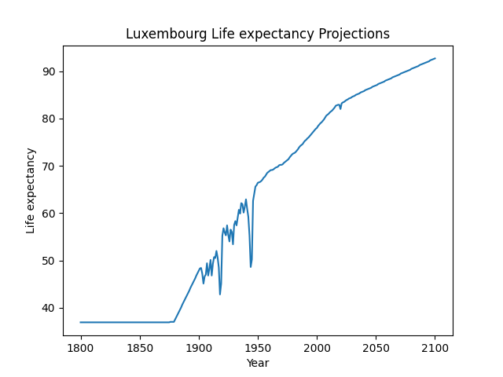
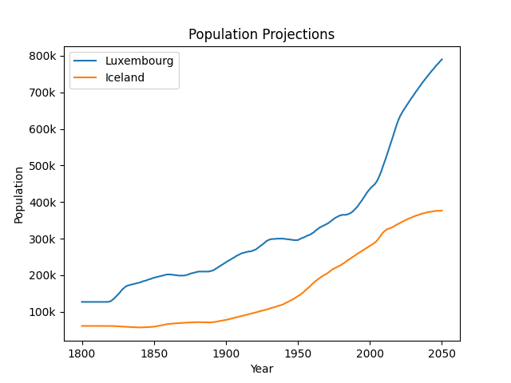
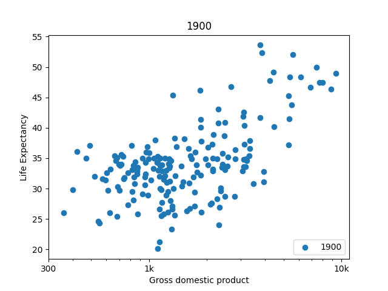

# Python - 2 - DataTable

## Grade

-

## Exercises

| Ex | Title | Files | Status |
|----|-------|-------|--------|
| 00 | Load my Dataset | `load_csv.py` | Done |
| 01 | Draw my country | `load_csv.py`, `aff_life.py` | Done |
| 02 | Compare my country | `load_csv.py`, `aff_pop.py` | Done |
| 03 | Draw my year | `load_csv.py`, `projection_life.py` | Done |

Datasets used by the exercises are in [`assets/`](assets).

## Highlights

**ex00: loader.** Every exercise reuses one `load()` that prints the
dimensions and returns `None` on a bad path or format.

**ex01: Luxembourg life expectancy, 1800–2100:**



**ex02: Luxembourg vs Iceland.** Population strings like `3.25M`/`127k`
are converted to numbers and the y axis is formatted back as k/M:



**ex03: life expectancy vs GDP in 1900**, log x axis. A positive but
loose correlation: richer countries tended to live longer.



## Run an exercise

```bash
cd ex01
python3 aff_life.py
```
